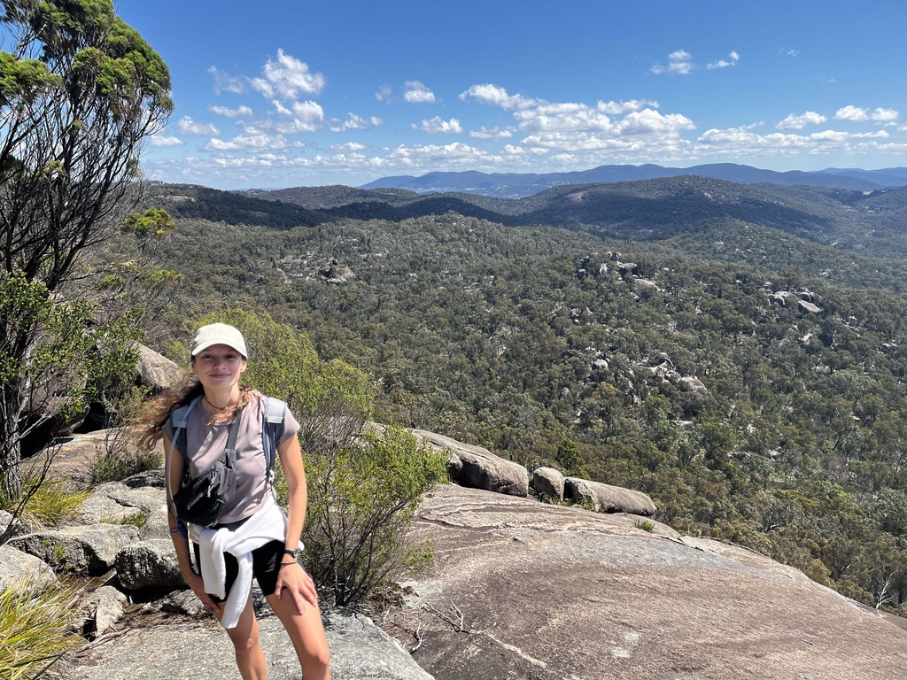

::::: {.hero}
::: {.hero-photo}
{fig-alt="Portrait of Zoe"}
:::

::: {.hero-text}
::: {.hero-kicker}
Postdoctoral fellow · Australian Institute of Marine Science
:::

::: {.hero-name}
Hi, I am Zoe (she/her)
:::

I am a population geneticist, currently working as a postdoctoral fellow at the Australian Institute of Marine Science. My research combines genomic data with ecological and environmental information to learn more about the evolutionary history and adaptive potential of Great Barrier Reef corals. I am particularly interested in using fundamental eco-evolutionary knowledge to predict the fate of climate-threatened species and populations, and to inform conservation efforts.

I grew up in the French Caribbean, where I first fell in love with tropical coral reefs. That curiosity led me to study biology in Roscoff, evolutionary biology in Europe, and then move to Australia for my PhD. I was privileged to have a supportive family that prioritised education, and I care about increasing diversity in science.

I am always happy to discuss potential collaborations, so please feel free to reach out if you are interested in working together!

::: {.chips}
[Population genomics]{.chip} [Evolutionary ecology]{.chip} [Climate adaptation]{.chip} [Conservation genomics]{.chip}
:::

:::
:::::

## Education and research experience

::: {.cv-item}
::: {.cv-date}
2026 – present
:::
::: {.cv-details}
**Postdoctoral fellow in Population Genomics and Bioinformatics**\
Australian Institute of Marine Science, Australia
:::
:::

::: {.cv-item}
::: {.cv-date}
2025 – 2026
:::
::: {.cv-details}
**Postdoctoral fellow in Marine Population Genomics**\
University of Queensland, Australia
:::
:::

::: {.cv-item}
::: {.cv-date}
2021 – 2025
:::
::: {.cv-details}
**PhD in Marine Population Genomics**\
University of Queensland, Australia
:::
:::

::: {.cv-item}
::: {.cv-date}
2017 – 2019
:::
::: {.cv-details}
**MSc in Evolutionary Biology** (Erasmus Mundus MEME programme)\
Uppsala University, Sweden\
Ludwig Maximilian University, Germany
:::
:::

::: {.cv-item}
::: {.cv-date}
2014 – 2017
:::
::: {.cv-details}
**BSc in Biology and Mathematics**\
Pierre and Marie Curie University at Roscoff Research Station, France
:::
:::