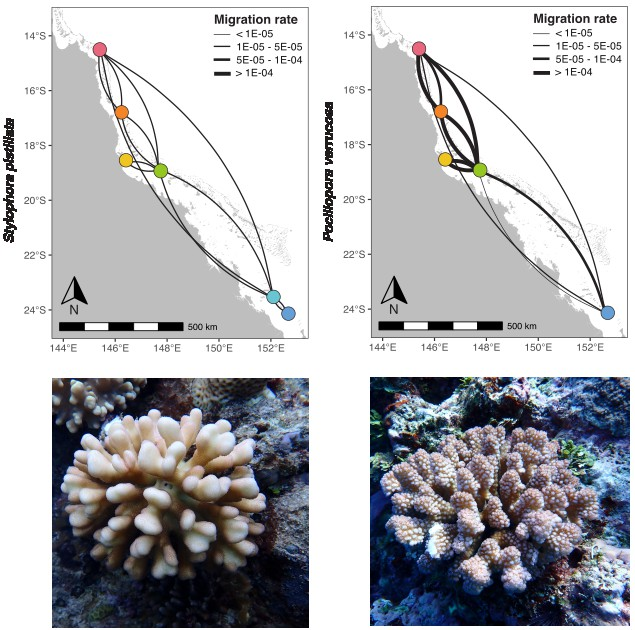
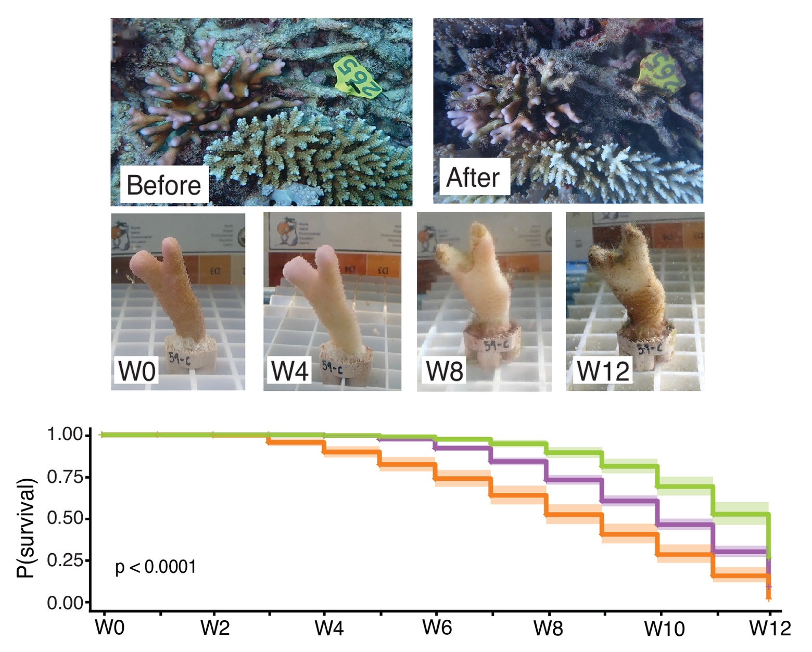

## Speciation in the *Stylophora pistillata* species complex

::::: {.research-item}
::: {.research-text}
*Stylophora pistillata* is currently taxonomically recognised as one nominal species, but using reduced representation sequencing data from 379 coral colonies, we discovered five genetically distinct and sympatric taxa across the Great Barrier Reef. Demographic modelling revealed that speciation events occurred with ongoing or episodic gene flow, and that these five taxa are at different stages along a continuum of genetic divergence. Significant correlations between genetic divergence and environmental variables suggest that niche partitioning may have played a role in the formation of this species complex.

Published in *Evolutionary Applications*

[Read the paper →](https://onlinelibrary.wiley.com/doi/full/10.1111/eva.13644){.paper-link}
:::

::: {.research-figure}
{fig-alt="Genomic PCA and distribution of the five Stylophora pistillata taxa"}
:::
:::::

## Connectivity dynamics in co-distributed coral species

::::: {.research-item .reverse}
::: {.research-text}
Connectivity is one of the most fundamental processes driving the ecology and evolution of natural populations. Here, we investigated dispersal capacities and gene flow rates in two coral species: the brooding species *Stylophora pistillata* and the spawning species *Pocillopora verrucosa*. Using fine-scale spatial information and complementary approaches rooted in population genomics, I found that reproductive modes predict dispersal variance, with meter-scale dispersal in *S. pistillata* and kilometer-scale dispersal in *P. verrucosa*, which in turn affect long-term levels of gene flow and shape genetic diversity patterns across populations.

Published in *Science Advances*

[Read the paper →](https://www.science.org/doi/10.1126/sciadv.adt2066){.paper-link}
:::

::: {.research-figure}
{fig-alt="Migration rates for two coral species with contrasting reproductive strategies"}
:::
:::::

## Coral common garden experiment during a heatwave

::::: {.research-item}
::: {.research-text}
In the summer of 2024, the Great Barrier Reef was hit by a fifth mass bleaching event, which particularly affected the southern region. To investigate differences in heat stress responses in the *Stylophora pistillata* species complex during this extreme heat event, we set up a 3-month-long common garden at Heron Island Research Station. From this experiment, we could disentangle the effect of intrinsic sensitivity (i.e., the identity of the host, the symbionts and genetic adaptation) from environmental exposure on phenotypic responses.

Published in *Proceedings B*

[Read the paper →](https://royalsocietypublishing.org/rspb/article/293/2072/20260890/481988/Heatwave-winners-and-losers-cryptic-coral){.paper-link}
:::

::: {.research-figure}
{fig-alt="Phenotypic responses of corals under common garden conditions"}
:::
:::::